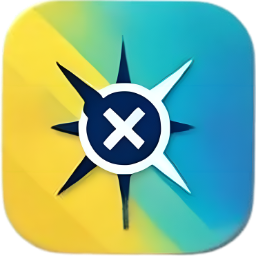
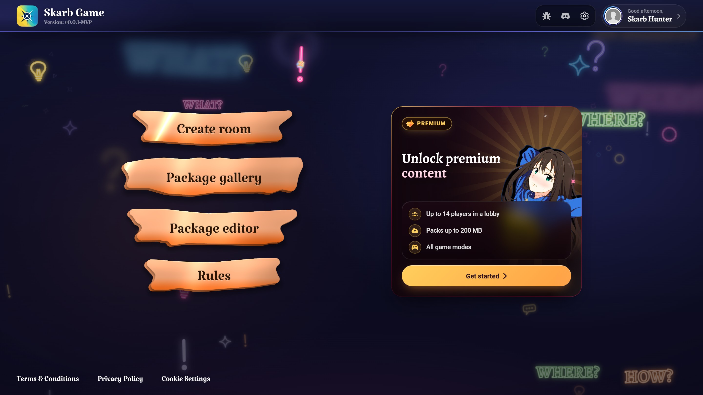
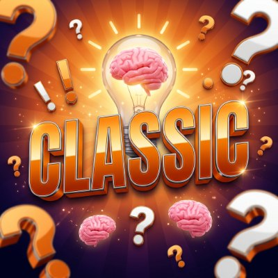
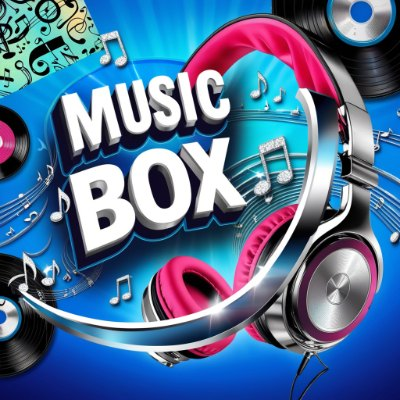
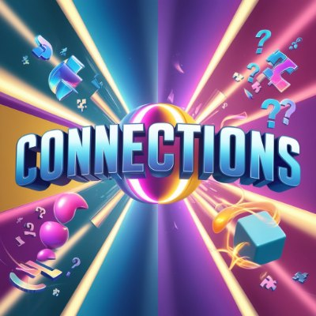
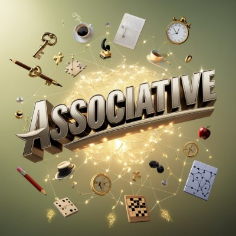

# Skarb Game

### A team trivia game with a live host

Gather your friends in a room, split into teams and battle for points — 
with questions, music, pairs and associations. Right in your browser.

 

[![Discord][badge-discord]][discord]
[![Support the project][badge-donate]][donate]
![Status: MVP][badge-status]
![12 languages][badge-langs]

 

The main menu

 

## 🎯 The idea

**Skarb Game** brings quiz night with friends online. Every match is run by a **real person**: the host opens the tasks, keeps an eye on the timer and decides whether an answer counts. **Teams** compete for points while **spectators** cheer from the side.

Everything a game needs lives in a single **`.sg` package**. Build one in the built-in editor, find one in the community gallery or get it from friends — and a minute later you're hosting your own game on any topic, from movies and anime to the history of your hometown.

### Your first game in four steps

| 📦 Get a package | 🚪 Create a room | 👥 Gather the teams | 🏆 Play |
| :-: | :-: | :-: | :-: |
| Build your own in the editor or pick a ready one from the gallery | Upload the package — the game validates it and shows the settings for every round | Share the link: someone takes the host seat, everyone else forms teams | Round after round, all the way to the final leaderboard |

## 🎮 Game modes

Each round has its own mode, so a single package can test knowledge, hearing and quick thinking in turn.

<table>
  <tr>
    <td align="center" valign="top" width="25%">
       
      <b>Classic</b> 
      ✅ Free  
      A question on the board and an answer: free text or one of the offered options. Works with any topic.
    </td>
    <td align="center" valign="top" width="25%">
       
      <b>Music Box</b> 
      ⭐ Premium  
      A track plays while its words hide behind cards. Open them one by one and guess before your rivals do.
    </td>
    <td align="center" valign="top" width="25%">
       
      <b>Connections</b> 
      ⭐ Premium  
      Match every pair on the board: a country with its capital, a still with its movie. The server checks the pairs, so it's always fair.
    </td>
    <td align="center" valign="top" width="25%">
       
      <b>Associative</b> 
      ⭐ Premium  
      Say all the correct words out loud: "name five…" prompts, riddles, guessing from an image. The host reveals every word you get.
    </td>
  </tr>
</table>

## ✨ Features

- 🎙️ **Live host** — timer, pause, "peek at the answer", jumping to any round and editing scores by hand.
- 👥 **Teams or solo** — play with a team or on your own: points always belong to the team.
- 🛠️ **Package editor** — formatted text, images, audio and video. The draft is saved in your browser, so your work never gets lost.
- 🗂️ **Package gallery** — a community catalog with filters, ratings and an "I'm feeling lucky" button.
- 👀 **Spectators** — watch a match live even when you're not playing.
- 🌍 **12 languages** — Ukrainian, English, Crimean Tatar, Ukrainian Latin, Polish, Lithuanian, Latvian, Estonian, Georgian, Spanish, French and German.
- 🔐 **Quick sign-in** with Google or Discord.

### Free vs Premium

| | Free | ⭐ Premium |
| --- | :-: | :-: |
| Players per room | 6 | 14 |
| Package size | 40 MB | 200 MB |
| Round modes | Classic only | All four |
| Spectators | — | ✓ |

## 💬 Discord community

Discord is the heart of Skarb Game. Join us to:

- 🎲 find opponents or a team for game night;
- 📦 share your packages and play other people's;
- 📣 be the first to hear about updates and new modes;
- 🐞 report a bug or suggest an idea — the developers are right there.

[][discord]

## 💛 Support the project

> Great projects start with small steps. Today we're building our MVP, and tomorrow we're launching a solution that lets you change the rules of the game! Your donation is not just money — it's a vote of confidence in the idea. Support the project — and we promise not to spend it all on coffee (only a little on tea 😋).

[][donate]

## 📬 Contact

- 💬 Discord — [discord.gg/QScwHNFeA3][discord]
- ✉️ Email — [skarb.game.support@gmail.com](mailto:skarb.game.support@gmail.com)

 

 
Made with 💛💙 for everyone who loves a good quiz

<!-- ─── Links ───────────────────────────────────────────────────────────────
     Donation: replace "#donate" below with your link — it updates both places
     (the badge at the top and the button in "Support the project"). -->

[discord]: https://discord.gg/QScwHNFeA3
[donate]: #donate

[badge-discord]: https://img.shields.io/badge/Discord-Community-5865F2?style=for-the-badge&logo=discord&logoColor=white
[badge-donate]: https://img.shields.io/badge/Support-the_project-FFB547?style=for-the-badge&logo=data%3Aimage%2Fsvg%2Bxml%3Bbase64%2CPHN2ZyB4bWxucz0iaHR0cDovL3d3dy53My5vcmcvMjAwMC9zdmciIHZpZXdCb3g9IjAgMCAyMCAyMCI%2BPHBhdGggZmlsbD0iIzNCMUYwQSIgZD0iTTcuNDQxNDEgMi42ODc1TDguODAwNzggNUg4Ljc1SDUuOTM3NUM1LjA3NDIyIDUgNC4zNzUgNC4zMDA3OCA0LjM3NSAzLjQzNzVDNC4zNzUgMi41NzQyMiA1LjA3NDIyIDEuODc1IDUuOTM3NSAxLjg3NUg2LjAyMzQ0QzYuNjA1NDcgMS44NzUgNy4xNDg0NCAyLjE4MzU5IDcuNDQxNDEgMi42ODc1Wk0yLjUgMy40Mzc1QzIuNSA0IDIuNjM2NzIgNC41MzEyNSAyLjg3NSA1SDEuMjVDMC41NTg1OTQgNSAwIDUuNTU4NTkgMCA2LjI1VjguNzVDMCA5LjQ0MTQxIDAuNTU4NTk0IDEwIDEuMjUgMTBIMTguNzVDMTkuNDQxNCAxMCAyMCA5LjQ0MTQxIDIwIDguNzVWNi4yNUMyMCA1LjU1ODU5IDE5LjQ0MTQgNSAxOC43NSA1SDE3LjEyNUMxNy4zNjMzIDQuNTMxMjUgMTcuNSA0IDE3LjUgMy40Mzc1QzE3LjUgMS41MzkwNiAxNS45NjA5IDAgMTQuMDYyNSAwSDEzLjk3NjZDMTIuNzMwNSAwIDExLjU3NDIgMC42NjAxNTYgMTAuOTQxNCAxLjczNDM4TDEwIDMuMzM5ODRMOS4wNTg1OSAxLjczODI4QzguNDI1NzggMC42NjAxNTYgNy4yNjk1MyAwIDYuMDIzNDQgMEg1LjkzNzVDNC4wMzkwNiAwIDIuNSAxLjUzOTA2IDIuNSAzLjQzNzVaTTE1LjYyNSAzLjQzNzVDMTUuNjI1IDQuMzAwNzggMTQuOTI1OCA1IDE0LjA2MjUgNUgxMS4yNUgxMS4xOTkyTDEyLjU1ODYgMi42ODc1QzEyLjg1NTUgMi4xODM1OSAxMy4zOTQ1IDEuODc1IDEzLjk3NjYgMS44NzVIMTQuMDYyNUMxNC45MjU4IDEuODc1IDE1LjYyNSAyLjU3NDIyIDE1LjYyNSAzLjQzNzVaTTEuMjUgMTEuMjVWMTguMTI1QzEuMjUgMTkuMTYwMiAyLjA4OTg0IDIwIDMuMTI1IDIwSDguNzVWMTEuMjVIMS4yNVpNMTEuMjUgMjBIMTYuODc1QzE3LjkxMDIgMjAgMTguNzUgMTkuMTYwMiAxOC43NSAxOC4xMjVWMTEuMjVIMTEuMjVWMjBaIi8%2BPC9zdmc%2B&labelColor=FFD877
[badge-status]: https://img.shields.io/badge/Status-MVP-0E1B48?style=for-the-badge
[badge-langs]: https://img.shields.io/badge/Languages-12-2BB5C8?style=for-the-badge
